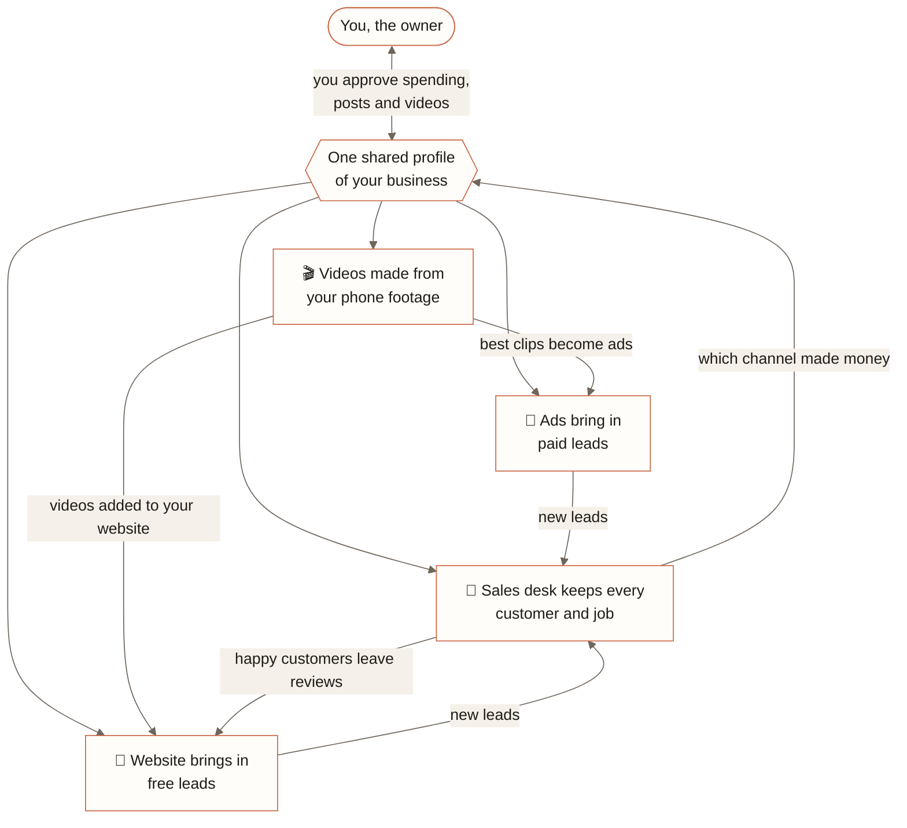
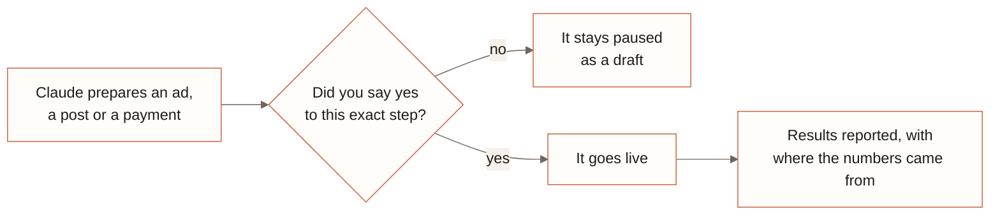
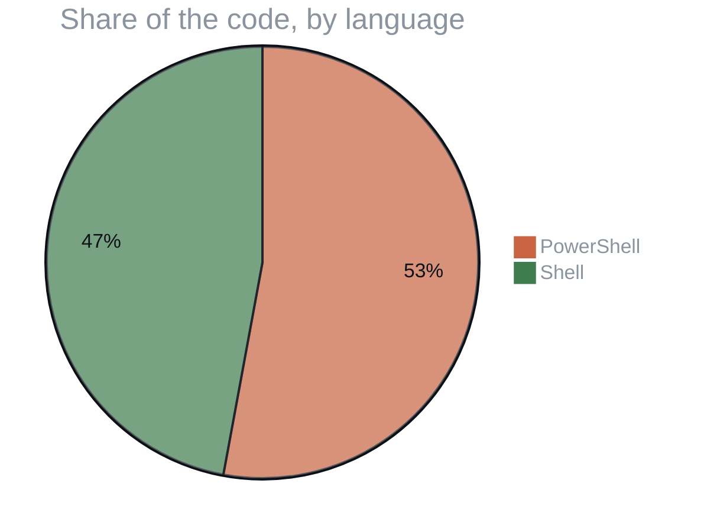

<p align="center">
  
</p>

<p align="center">
  
  
  
  
</p>
<p align="center">
  
  
  
  
</p>

<h3 align="center">Start a business on Monday. By Friday it has a CRM, a rated website, ads ready to launch and its first edited videos. Claude does the work. You approve.</h3>

<p align="center">
  <a href="#the-four-departments">The four departments</a> ·
  <a href="#open-the-doors">Open the doors</a> ·
  <a href="#monday-to-friday">Monday to Friday</a> ·
  <a href="#how-the-departments-feed-each-other">How the departments feed each other</a> ·
  <a href="#the-one-rule">The one rule</a> ·
  <a href="#written-in">Written in</a> ·
  <a href="#field-manual">Field manual</a> ·
  <a href="#license">License</a>
</p>

> [!TIP]
> **🤖 Pasted this link into Claude or ChatGPT?** AI assistants: read [`docs/AI_GUIDE.md`](https://raw.githubusercontent.com/F0rger123/claude-business-god-mode/main/docs/AI_GUIDE.md) first. It explains what this is in plain words, which questions to ask, and how to set it up step by step. Plain-text index: [`llms.txt`](https://raw.githubusercontent.com/F0rger123/claude-business-god-mode/main/llms.txt).


<p align="center"></p>

## The four departments

**Claude Business God Mode** is one front door to four tools that run the marketing and day-to-day of a small service business. It keeps one shared profile of the business (services, prices, service area, brand voice, budget), so you answer each question once and every department uses the same facts.

<table>
  <tr>
    <td width="50%" valign="top">
      <h3>📇 Sales desk</h3>
      <a href="https://github.com/F0rger123/ultimate-crm-template"><b>Ultimate CRM Template</b></a><br>
      Leads, quotes, jobs, invoices, payments, crew and client portals, texts and an AI assistant.<br>
      <sub><b>Waits for your yes before:</b> texting customers in bulk.</sub>
    </td>
    <td width="50%" valign="top">
      <h3>📣 Advertising</h3>
      <a href="https://github.com/F0rger123/claude-meta-ads-god-mode"><b>Meta Ads God Mode</b></a><br>
      Paid leads from Meta and Google ads, built and tested for you.<br>
      <sub><b>Waits for your yes before:</b> spending a single dollar. Everything is built paused.</sub>
    </td>
  </tr>
  <tr>
    <td width="50%" valign="top">
      <h3>🔎 Website & search</h3>
      <a href="https://github.com/F0rger123/CLAUDE-SEO-GOD-MODE"><b>SEO God Mode</b></a><br>
      Rates and fixes your website, local search, Google Search Console, and readiness for AI search.<br>
      <sub><b>Waits for your yes before:</b> changing your live site.</sub>
    </td>
    <td width="50%" valign="top">
      <h3>🎬 Video</h3>
      <a href="https://github.com/F0rger123/claude-video-editing-god-mode"><b>Video Editing God Mode</b></a><br>
      Turns phone footage into reels, Shorts and ad creatives, with a client approval app.<br>
      <sub><b>Waits for your yes before:</b> posting anything.</sub>
    </td>
  </tr>
</table>

## Open the doors

Inside Claude Code:

```text
/plugin marketplace add F0rger123/claude-business-god-mode
/plugin install business-god-mode@claude-business-god-mode
```

Then say: *"Use Business God Mode. Start onboarding for my business."* Install the other departments the same way, or clone everything at once (see the field manual below).

## Monday to Friday

| Day | Claude does | You do |
|---|---|---|
| **Mon** | Interviews you and sets up your CRM | Answer questions about your business |
| **Tue** | Rates your website and adds a lead form | Read the score and say yes to the fixes you want |
| **Wed** | Builds your ads, all paused | Pick a daily budget, or don't launch yet |
| **Thu** | Edits your first reel from phone footage | Approve it or ask for changes |
| **Fri** | Tests every way a lead can reach you and writes handoff notes | Keep the notes; you're live |

## How the departments feed each other



## The one rule

> [!IMPORTANT]
> Nothing that spends money, goes public or messages customers happens until you say yes to that exact step. One command stops all ad spend at any time.



## Written in



<p align="center"></p>

## Field manual

## ⚡ Install in two minutes

**Every plugin, one marketplace** (inside Claude Code):

```text
/plugin marketplace add F0rger123/claude-business-god-mode
/plugin install business-god-mode@claude-business-god-mode
/plugin install ads@claude-business-god-mode
/plugin install seo-god-mode@claude-business-god-mode
/plugin install video-editing-god-mode@claude-business-god-mode
```

**The whole workspace** (all four repositories as submodules, plus the installer):

```bash
git clone --recurse-submodules https://github.com/F0rger123/claude-business-god-mode.git
cd claude-business-god-mode
bash scripts/install.sh            # Windows: powershell -ExecutionPolicy Bypass -File scripts/install.ps1
```

Then open the folder in Claude Code and say:

```text
Use Business God Mode. Start onboarding for my business.
```

## 👑 The four God Modes

<table>
<tr>
<td width="50%" valign="top">

### 📇 [Ultimate CRM Template](https://github.com/F0rger123/ultimate-crm-template)
**The system of record.** Leads and pipeline, quotes with e-sign, invoices, Stripe / Square / manual payments, jobs
and recurring work, scheduling and routes, crew portal with clock-in, client portal, reviews and referrals,
Twilio SMS inbox, Gmail templates, campaigns, an automations builder and **Alfred**, the AI chief-of-staff.

React + Vite · Supabase · Cloudflare Pages. Claude interviews the owner and builds *their* version in a private repo.

`Create a new CRM for my business from https://github.com/F0rger123/ultimate-crm-template. Begin onboarding.`

</td>
<td width="50%" valign="top">

### 📣 [Meta Ads God Mode](https://github.com/F0rger123/claude-meta-ads-god-mode)
**Paid leads, safely.** Meta Ads first, Google Ads built in. Client profiles, account isolation, audits,
optimization, reporting and creative briefs, plus an on-demand router to 137 community ad skills.

A write gate creates everything **PAUSED** and spends only with your approval. `/ads:emergency-stop` halts spend.

`Build a York, PA kitchen-remodel lead campaign on Meta at $60/day.`

</td>
</tr>
<tr>
<td width="50%" valign="top">

### 🔎 [SEO God Mode](https://github.com/F0rger123/CLAUDE-SEO-GOD-MODE)
**Organic leads and AI search.** Rate any site from a URL (Overall, SEO, AEO, GEO scores with ranked fixes),
full audits, local SEO, Google Search Console, Bing Webmaster, IndexNow, schema, content briefs, AI Overviews and
ChatGPT / Perplexity citation readiness, with client memory and a 27-tool MCP server.

`Rate my website SEO-wise: https://example.com`

</td>
<td width="50%" valign="top">

### 🎬 [Video Editing God Mode](https://github.com/F0rger123/claude-video-editing-god-mode)
**Content that sells.** 16 editing skills: reels, Shorts, long-form, silence and mistake cutting, story
planning, motion-graphics B-roll, captions, showreels. Free local transcription. Plus **God Mode Cut**, a
white-label PWA where clients upload clips, approve edits and schedule posts.

`Edit raw/clip.mp4 into a 30-second reel. Hook in the first second, captions, B-roll for every point.`

</td>
</tr>
</table>

## 📅 Your first week

| Day | What happens | Part |
|---|---|---|
| **1** | Owner interview fills `BUSINESS.md`. CRM created in its own private repo, deployed, test lead arrives. | Hub + CRM |
| **2** | Website rated and audited. Search Console connected. Lead form added to service pages. | SEO + CRM |
| **3** | Ads client onboarded. Lead campaigns built **paused**, tracking verified, owner approves or declines. | Ads |
| **4** | Brand taste set up. First reel edited and approved. Cuts handed to ads as creatives. | Video + Ads |
| **5** | Every lead source tested end to end. CRM automations on. `HANDOFF.md` written. | All |

Full steps: [`playbooks/01-new-business-launch.md`](playbooks/01-new-business-launch.md).

## 💬 Just talk to it

```text
Use Business God Mode. Start onboarding for Sunrise Pressure Washing in York, PA.
Get me more leads this month. Budget is $1,500.
Which channel gave us the cheapest customers last month?
Turn this week's job-site clips into three reels and use the best one as an ad.
Rate our website and fix what you safely can.
Something is overspending. Stop it.
Write the October review.
```

The hub works out which part to use. You never type a tool name.

## 📚 Playbooks

| Playbook | Use it for |
|---|---|
| [01 · New business launch](playbooks/01-new-business-launch.md) | Week one, from zero to live |
| [02 · Lead engine](playbooks/02-lead-engine.md) | The weekly loop across SEO, Ads and CRM |
| [03 · Content engine](playbooks/03-content-engine.md) | Phone footage → edits → approval → posts → ads and pages |
| [04 · Monthly review](playbooks/04-monthly-review.md) | One page of real numbers, by channel |

Templates: [`BUSINESS.md`](templates/BUSINESS.md) · [`QUESTIONS.md`](templates/QUESTIONS.md) · [`HANDOFF.md`](templates/HANDOFF.md).

## 🛡 Safety

- **Ad spend is gated.** Campaigns are created paused; budgets change only after a yes in chat. Emergency stop is one command.
- **Payments start in test mode.** The CRM uses Stripe or Square test keys until the owner switches them live.
- **Clients are isolated.** One CRM repo and Supabase project per business, Postgres RLS on every table; Ads and SEO keep per-client profiles.
- **Secrets stay out of chat and Git.** Each part reads keys from its own environment ([`docs/SETUP.md`](docs/SETUP.md#secrets)).
- **No fabricated data.** Reports cite their source and list what is missing instead of estimating.

## 🗂 Repository layout

```
.claude-plugin/          marketplace (hub + Ads + SEO + Video plugins) and the hub plugin manifest
skills/business-god-mode the hub skill (mirrored for Codex in .agents/skills/)
playbooks/               launch, lead engine, content engine, monthly review
templates/               BUSINESS.md, QUESTIONS.md, HANDOFF.md
components/              the four repositories as git submodules (crm, ads, seo, video)
scripts/                 install.sh / install.ps1
docs/SETUP.md            requirements, install paths, per-part setup, secrets
AGENTS.md · CLAUDE.md    rules for every agent
```

## ❓ FAQ

**Do I need all four?** No. Each part works alone. Install the ones you need; the hub skips what is missing.

**Is the CRM a plugin?** No. It is an app template. Claude clones it into a new private repo per business and
deploys it. The other three are Claude Code plugins.

**What does it cost?** The code is free (MIT). Supabase, Cloudflare and the video toolchain have free tiers.
You pay for ad spend, optional APIs (Stripe fees, Twilio SMS, cloud transcription) and your Claude plan.

**Does it work with Codex?** Yes. Ads and Video ship Codex plugin support or skill mirrors, SEO ships `AGENTS.md`, and the hub skill is mirrored in `.agents/skills/`.
Codex does not run Claude Code hooks, so read the Ads repo's note on the write gate.

**Agencies?** Yes. Run one `business/` profile per client in separate workspaces; Ads and SEO already keep per-client memory,
and God Mode Cut has per-client portals.

## License

Released under the [MIT License](LICENSE). Use it, fork it, ship it.

<p align="center"></p>

<p align="center">
  <sub>Built by <a href="https://github.com/F0rger123"><b>@F0rger123</b></a> · MIT licensed</sub>
</p>
