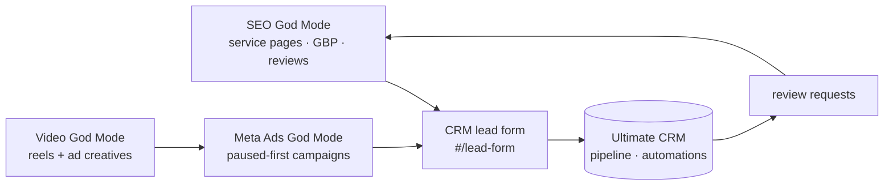

# Playbook 02: Lead engine

Goal: more qualified leads at a known cost, every one tracked in the CRM.

## Weekly loop

1. **Measure (CRM).** Leads this week by source, cost per lead (ad spend ÷ ad leads), close rate by source.
2. **Organic (SEO).** *"Which of our pages don't answer the questions people actually search? Use Search Console."*
   Pick one page to improve or create per week. Every service page carries the lead form.
3. **Paid (Ads).** *"Review <client> ads this week. Show me what wasted the most spend."* Propose changes; apply only
   after approval. New creatives come from the video queue.
4. **Speed to lead (CRM).** Set automations that text new leads right away and remind the owner of quotes older than
   two days.
5. **Reviews (CRM to SEO).** Every completed job triggers a review request. SEO God Mode checks review velocity on
   Google Business Profile monthly.

## Guardrails

- No budget increase without the owner's written yes in chat.
- If cost per lead rises above the target in `BUSINESS.md` for seven days, pause the worst ad set (approval needed)
  and report why.
- Never buy leads or reviews. Never gate reviews (asking only happy customers) on platforms that forbid it.
